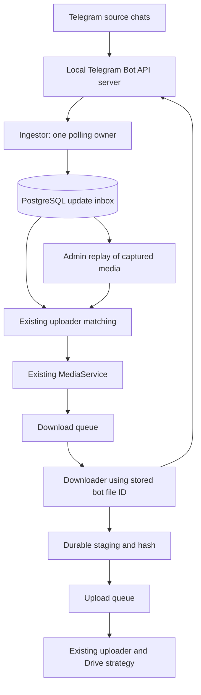

# Bot media ingestion implementation plan

Status: implemented and locally verified. The additive migration has been rehearsed only against an isolated database. Production bot endpoint migration, configuration and live pilot remain deployment steps in [operations](reference/operations.md).

## Confirmed scope

Horison confirmed on 2026-11-19:

- The source chats are controlled by the operator, who can add the bot and grant visibility.
- Only new media is required; importing old Telegram history is outside scope.
- Source files exceed 20 MB. A self-hosted Telegram Bot API server is part of the baseline deployment.
- Media scanning and downloading must work without a human Telegram session.

Preserve the current uploader eligibility, attachment identity, album association, received edits, download/upload queues, staging, retries, reporting and selected Drive strategy. Preserve current semantics: an uploaded slot is not automatically uploaded again because an edit changes its file identity. This migration does not resolve unrelated Drive completion or destination problems recorded in [status](status.md).

Campaign sending and arbitrary username resolution are a separate scope decision. They currently use the account gateway. Keeping them temporarily must be explicit in deployment settings; the scanner and downloader must not depend on their credentials. There must be no automatic user-account fallback for scanning.

## Feasibility and limits

| Area | Planned behavior |
| --- | --- |
| New group media | Add the bot; grant admin visibility or disable group privacy and re-add it. Verify ordinary media delivery in every source chat. |
| Large files | Use the local Bot API server in local mode. Hosted file downloads are limited to 20 MB. |
| Old history | No historical scanner. Telegram restricts `messages.getHistory` to user accounts. |
| Restart recovery | Persist received updates before acknowledgment; retry captured work from PostgreSQL. Telegram pending updates are retained for at most 24 hours. |
| Later uploader registration | Retain unmatched captured media for explicit local replay after registration. This is replay of captured data, not a Telegram history scan. |
| Channels and anonymous senders | Receiving a post does not establish its human author. Preserve explicit eligibility checks; do not infer a person from a signature or chat identity. |
| Remaining account features | Inventory and explicitly enable or disable them independently from scanning. |

These limits follow the [Telegram history method](https://core.telegram.org/method/messages.getHistory), [Bot API reference](https://core.telegram.org/bots/api), and [privacy documentation](https://core.telegram.org/bots/features#privacy-mode). A local server needs application `api_id` and `api_hash`, as described by its [official server repository](https://github.com/tdlib/telegram-bot-api#usage); these are application credentials, not a runtime human-session login.

## Current implementation evidence

| Source | Current responsibility and migration impact |
| --- | --- |
| [Ingestor](../apps/ingestor/src/ingestor.service.ts) | GramJS live/edit listeners; active uploader matching by sender ID then username; reconciliation currently combines stale recovery and history. |
| [Gateway](../packages/shared/src/telegram/telegram-gateway.ts) | User-session connection, history, message refetch before download, outbound sends and identity resolution. |
| [Media service](../packages/shared/src/services/media.service.ts) | Slot upsert, queue handoff, ownership leases, staging and stale-item recovery. Preserve these invariants. |
| [Downloader](../apps/worker-downloader/src/downloader.service.ts) | Always connects the user gateway before consuming work. Replace this dependency for bot downloads. |
| [Summary bot](../apps/stats-api/src/bot.service.ts) | grammY commands and daily summaries; polls with `drop_pending_updates: true`. It must not compete with the ingestion receiver. |
| [Schema](../prisma/schema.prisma) | Legacy Telegram file IDs; bigint album IDs; slot and file uniqueness constraints. Add explicit transport identity and bot inbox state. |
| [Environment](../packages/shared/src/config/env.ts) | Human session, phone number and application credentials are globally required today. Separate validation by enabled capability. |
| [Messages service](../apps/stats-api/src/messages.service.ts) | Account-based campaign sends, startup connection and public username lookup. |
| [Uploader](../apps/worker-uploader/src/uploader.service.ts) | Resolves notification-whitelist identities through the account gateway. Decouple this dependency for a session-free media pipeline. |

See the [architecture](reference/architecture.md), [media specification](../specs/media-ingestion.md), and [current backfill boundary](../specs/manual-backfill.md) for existing behavior. The following sections describe proposed behavior only.

## Proposed architecture

Reuse grammY and the existing PostgreSQL/Redis services. Add a focused bot client and inbox service; keep legacy account operations isolated instead of forcing unsupported history methods into a common implementation. Do not add a new broker or support both webhooks and polling in this change.

### Reception and durability

- The ingestor is the sole `getUpdates` owner per bot identity. Enforce one instance in process configuration and use a renewable ownership lease to prevent accidental overlapping receivers. Stop starting requests when ownership is lost; resolve in-flight polling before takeover.
- Use an explicit polling handoff: transactionally store the received batch and its next polling offset before requesting a higher offset. A database failure must prevent acknowledgment. Do not rely on a middleware error handler to provide this guarantee.
- Deduplicate updates by bot identity and update ID. Keep the receipt cursor separate from chat message IDs and inbox processing state. Account for Telegram's update-sequence reset after a long idle period; do not treat update IDs as permanent historical high-water marks.
- Receive new/edited messages, new/edited channel posts, and bot membership changes. Route summary commands through the same receiver; commands must not block media intake.
- Process the durable inbox independently. If persistence succeeds but Redis enqueue fails, retry the inbox item. If enqueue succeeds but marking the item processed fails, replay through existing media deduplication.
- Record unmatched uploader messages as retained unmatched work. They must not block subsequent updates, and they must remain eligible for local replay. Keep inactive/unknown uploaders unauthorized until the usual checks pass.
- Keep replay within configured source chats. Persist supported media metadata and receipt outcomes; do not expand the bot to collect unrelated chats.
- Define inbox retention to cover the operator's registration/replay window; expose that window and capture start. Never purge unfinished recovery work. Do not invent a default retention promise without an operational decision.

### Media identity and download

- Keep `(chatId, messageId, mediaIndex)` as the attachment slot. Photo sizes are variants of one attachment: select the largest suitable photo, rather than counting each size as separate media. Album members remain separate messages.
- Treat `media_group_id` as an opaque string. Add a string album field or migrate the existing album representation losslessly after checking readers and serializers. Never blindly cast it to bigint.
- Add transport provenance and owning bot ID to stored download references. Persist Bot API `file_id` and `file_unique_id`; only `file_id` downloads a file. Existing MTProto IDs must remain explicitly legacy.
- Download from the stored Bot API reference without fetching the original message by chat/message ID. Resolve `getFile` on each attempt rather than persisting a temporary download URL.
- Share the local API server's file directory read-only with the downloader at a consistent path. Copy or stream the completed file into the existing staging workflow; do not remove the API server's cache file. Keep the staging directory visible to both workers as today.
- Preserve ownership heartbeat, conditional completion, partial-file cleanup, hash calculation, terminal-deleted guards and durable upload handoff. Avoid a new whole-file Buffer for large downloads.
- Use bot-appropriate bounded concurrency and honor `429 retry_after`; retain coordinated request gating on remaining account operations. Distinguish retryable Telegram/network failures from invalid references and local staging errors.
- Preserve existing classification deliberately: inspect animation, audio, voice, video-note and sticker payloads as well as photos/videos/documents because the current GramJS parser broadly accepts document media. Handle overlapping Bot API fields once. Do not silently narrow supported media types.
- Preserve per-message edit order during replay so an older captured event cannot replace a newer file reference. Keep the existing uploaded-slot behavior. Avoid stale completion writes if a reference changes during a download.

## Implementation sequence and acceptance gates

### 1. Local Bot API deployment and capability configuration

Change the [environment schema](../packages/shared/src/config/env.ts), [shared providers](../packages/shared/src/services/shared.module.ts), [environment example](../.env.example), and [process configuration](../ecosystem.config.cjs). Add a local API root and explicit validation for enabled bot/legacy capabilities. Require the bot token for scanning. Human phone/session settings must not be required by the scanner or downloader. Any retained account operations must be explicitly configured; disabled operations must not connect at startup.

Deploy the local API server with durable state and a file-cache volume accessible to the downloader. Point all clients sharing the ingestion token at the same API server, including notification clients. Follow Telegram's documented `logOut` procedure when moving an existing token from the hosted API. Stop the old summary poller without dropping pending updates. Keep the API endpoint internal and avoid logging tokens in request URLs.

**Verify:** `getMe` succeeds through the local endpoint; ordinary media arrives from a controlled test chat; a representative file over 20 MB is accessible from the downloader host; ingestion starts with human phone/session variables absent.

### 2. Add persistent inbox and compatible media metadata

Add a Prisma migration for bot receiver state and update inbox records, including payload, bot/update identity, receipt time, processing status, attempts and safe failure details. Store replay indexes by chat/date and processing state. Add media transport/bot ownership and string album identity as above. Keep legacy rows readable, retain existing uniqueness guarantees, and review alias collisions before changing chat IDs.

**Verify:** duplicate updates create one effective inbox entry; existing media slots remain unique; legacy identifiers cannot be interpreted as bot references; migration preserves uploaded rows, local paths and historical counts. A migration rehearsal must use a disposable database copy.

### 3. Replace live ingestion and coordinate summary commands

Update the [ingestor](../apps/ingestor/src/ingestor.service.ts) to receive bot updates and reuse its authorization/media processing path. Add focused receiver/parser/inbox services. Update the [summary bot](../apps/stats-api/src/bot.service.ts) so it no longer starts another poller for this token. Keep `/start`, `/today` and daily reporting available: route commands through the inbox owner and reuse summary formatting/query logic, while a send-only client may remain in stats API for scheduled reports. Remove startup update dropping from the ingestion token's lifecycle.

Read sender identity from the actual message sender; do not use forwarded origins or anonymous sender placeholders as authorization. Keep decimal-string HTTP IDs, bigint persistence, active-uploader matching and safe chat alias handling. Skip unidentifiable authors explicitly. An approved chat-level policy would be required to accept anonymous/channel posts without a registered human uploader.

**Verify:** photos, videos, representative document subtypes, albums and received edits follow existing eligibility; inactive/unknown users do not upload; registering an unknown user enables replay; command processing and service restart do not lose captured media; a second receiver cannot consume concurrently.

### 4. Replace downloader transport and decouple uploader identity lookup

Change [MediaService](../packages/shared/src/services/media.service.ts) and the [downloader](../apps/worker-downloader/src/downloader.service.ts) to use the bot download reference and local API files. Keep the ID-only queue payload unless a demonstrated need requires changing it. Close workers before their clients at shutdown.

Remove the [uploader](../apps/worker-uploader/src/uploader.service.ts) requirement to resolve whitelist identities through a human session. Preserve notification suppression using stored/observed identities or explicitly configured IDs; identify the current bot through `getMe`. Resolve and document any whitelist entries never observed by the bot instead of silently enabling account access.

**Verify:** a file over 20 MB reaches the selected Drive strategy; killing a download permits safe retry; losing upload enqueue preserves the staged file; wrong-bot/legacy references fail visibly; bot-only ingestion, download and upload run without a human session.

### 5. Replace history reconciliation with local recovery and replay

Split the [ingestor reconciliation job](../apps/ingestor/src/ingestor.service.ts): keep leased stale-item recovery and inbox retries, remove Telegram history calls from the bot scanning path. Retire history cursor advancement for that path without rewriting old checkpoints.

Adapt the [backfill service](../apps/stats-api/src/media-backfill.service.ts), its controller, [browser client](../apps/web-admin/src/services/api.ts), and [user-detail page](../apps/web-admin/src/pages/UserDetailPage.vue) to offer replay of captured media. Preserve date filters, preview, unknown-uploader visibility and idempotent run behavior. Identify the data source and available capture window in responses; do not silently claim historical coverage. Preview must remain free of media/job writes. Replay is not dependent on storing a Telegram history cursor.

**Verify:** no bot media path calls history RPCs; stalled work is still recovered; repeated local replay does not duplicate effective work; pre-capture dates show unavailable coverage instead of a misleading successful empty history scan.

### 6. Validate, document and cut over

Extend the existing relevant suites: [environment](../tests/env.spec.ts), [media lifecycle](../tests/media-service.spec.ts), [downloader](../tests/downloader-service.spec.ts), [reconciliation](../tests/reconciliation.spec.ts), [queue](../tests/queue-service.spec.ts), [uploader](../tests/uploader-service.spec.ts), [request gate](../tests/telegram-request-gate.spec.ts), [username resolution](../tests/telegram-username-resolution.spec.ts), and [messages controller](../tests/messages-controller.spec.ts). Create no new unit-test files under the project instruction.

Run affected suites, `npm test`, `npm run build`, `npm run build:web`, `npm test -- tests/documentation.spec.ts`, and `git diff --check` with Node 22 or newer. Run live pilot checks for local API access, large media, chat permissions, receiver failure before/after database commit, Redis outage, worker restart, duplicate delivery, edits and replay after registration. Mocked tests alone do not establish Telegram/Drive integration.

Update [architecture](reference/architecture.md), [environment](reference/environment.md), [operations](reference/operations.md), [API](reference/api.md), [media ingestion](../specs/media-ingestion.md), [backfill](../specs/manual-backfill.md), [spec index](../specs/INDEX.md), [status](status.md), and affected [Telegram](../.principles/code/telegram-access.md), [reconciliation](../.principles/code/reconciliation.md), [media](../.principles/code/media-lifecycle.md) and [lifecycle](../.principles/delivery/process-lifecycle.md) principles when implementation changes their source evidence. Report actual receiver/local API readiness rather than the current literal `telegram_connected: true`.

Before production cutover:

1. Inventory legacy queued/downloading/failed items. Staged items may resume upload. Items with only MTProto references require resubmission to the bot or a separately agreed legacy completion process; do not enable account scanning automatically.
2. Record the capture start per source chat and verify permissions with ordinary uploader media. Check legacy/canonical chat aliases without blindly changing primary keys or colliding slots.
3. Stop old receivers/history schedules, start the local server and the sole bot receiver, and preserve pending updates. Pilot one chat, then enable the remaining configured chats.
4. Check inbox lag, intake failures, unmatched counts, download/upload failures, local API health and staging/cache capacity. A quiet chat alone is not proof of failed intake; verify heartbeat and permissions separately.
5. If the pilot fails, pause dispatch while retaining the inbox, queues, staging and checkpoints. Resume after correcting the bot path; rollback must not automatically reactivate human-account scanning.

**Release acceptance:** eligible captured new media, including a representative file over 20 MB, completes the existing pipeline without a human Telegram session; duplicates/restarts remain recoverable; captured unmatched media can be replayed after registration; summary commands still work; the UI states the available capture window.

## Decisions remaining before implementation

| Decision | Recommended treatment |
| --- | --- |
| Existing campaigns and arbitrary username lookup | Keep outside this migration. Explicitly retain their legacy capability or disable it. Moving them to a bot requires recipient onboarding and lookup-contract changes; do not pretend bot chat lookup resolves arbitrary users. |
| Inbox retention/replay window | Agree an operational window; retain unresolved recovery work and display its bounds. |
| Anonymous/channel-authored posts | Retain current human-uploader eligibility. Add a separate chat-level policy only if required. |
| Legacy pending downloads without staged files | Prefer explicit resubmission when possible; agree disposition before switching workers. |
| Host and volumes | Confirm where local API state/cache, downloader and shared staging run; verify capacity for the largest representative files. |

## Verification

Planning used current source inspection and official Telegram documentation, with Winston, Amelia and John reviewing architecture, implementation and scope. The requested implementation was then completed on the current branch.

Measured on 2026-11-20 under Node 22.23.3:

- All 93 tests across the existing 12 test files passed; no new unit-test files were created. Backend and frontend production builds passed, as did Prisma validation/generation and documentation/whitespace checks.
- The migration was applied after all nine baseline migrations to an isolated PostgreSQL 15 database. An existing uploaded row, file identifier and staged path were preserved, with legacy transport defaults. Prisma reported no schema difference afterward.
- An isolated integration run used real PostgreSQL/Redis and the actual ingestor, queues, downloader and desktop uploader against a simulated local Telegram HTTP API. Two 24 MiB files completed the local desktop-copy pipeline without a human session. It verified persistence before acknowledgment, redelivery deduplication, lost-owner transaction rollback, unmatched-user retention/registration replay, read-only preview, one polling owner, restart deduplication and retry after a simulated upload failure.
- The pinned official Bot API Docker image built and returned `Bot API 10.4`; the Compose overlay validated.
- Independent review findings were patched: idle-boundary/late-update handling, sticky ownership loss, stale dispatcher outcomes, staged-edit/upload claims, retained-file upload retries, current-source health and bounded summary replies. Matching regressions were added to existing suites.

No production database migration, bot endpoint switch, real group test or remote Drive synchronization test was performed. Existing Drive completion semantics remain unchanged. Follow [setup and cutover](reference/operations.md#bot-setup-and-cutover) for those deployment steps.
